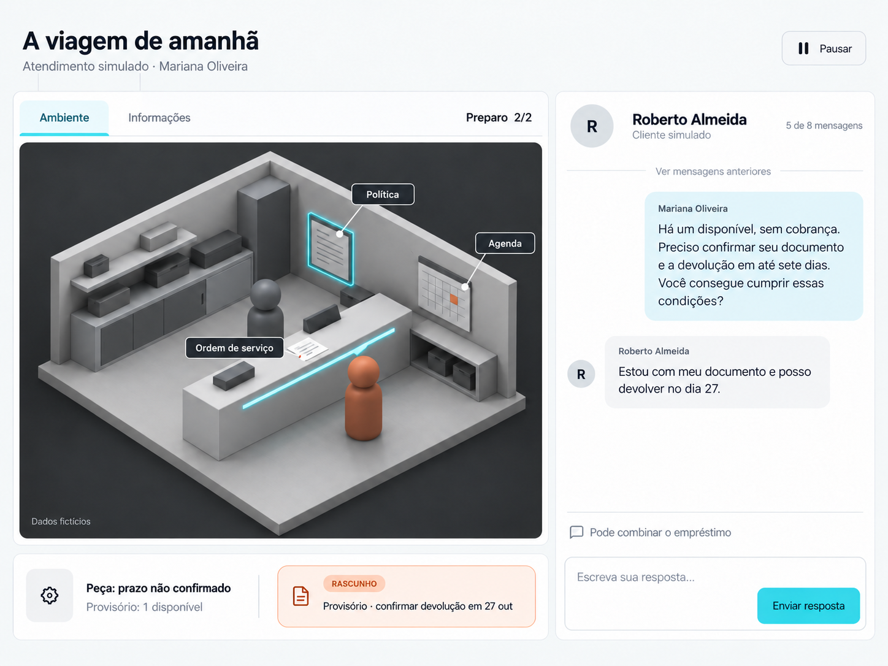

# Frontline

**Cada escolha tem uma consequência.**

Pratique conversas difíceis, entenda consequências e experimente outra resposta.

Frontline é um simulador narrativo de atendimento profissional. A pessoa prepara uma situação, conversa com um cliente fictício, consulta informações no ambiente e recebe uma avaliação ligada às próprias falas. Uma nova tentativa permite comparar decisões sem colocar um cliente real em risco.



*Idealização visual do produto. Esta imagem representa a direção de design; não é uma captura do aplicativo em execução.*

## Para quem

Mariana, nossa persona de design, está começando no suporte de uma empresa de comércio eletrônico. Ela conhece o procedimento, mas precisa praticar como explicar limites e negociar alternativas quando um cliente está frustrado. Roberto é o personagem do exercício — o cliente atendido por Mariana, não outro usuário da plataforma.

No episódio **A viagem de amanhã**, Roberto precisa de um aparelho antes de viajar. O reparo não tem prazo confirmado. Existe uma alternativa de empréstimo, mas suas condições precisam ser consultadas e confirmadas. O que Mariana responde muda o compromisso que pode assumir.

## A experiência

- **Preparar:** escolher um episódio ou descrever uma situação e revisar seu contexto.
- **Praticar:** conversar por texto em uma sala 2.5D com ordem de serviço, política e agenda.
- **Compreender:** receber três critérios de avaliação, trechos da conversa e uma melhoria concreta.
- **Experimentar:** repetir o exercício e comparar consequências, preservando a tentativa anterior.
- **Continuar:** retomar sessões salvas; WhatsApp e exportação verificável fazem parte da expansão planejada.

## Estado do projeto

**Protótipo em desenvolvimento, criado para o DevDay Community Hackathon São Paulo de 23 de outubro de 2026.** A proposta parte do desafio #5, com mecânicas narrativas inspiradas no #10. O recorte de inscrição é a simulação de atendimento profissional.

Esta primeira publicação reúne a especificação de produto e as dez idealizações visuais. O código do protótipo local está em integração e será publicado em um próximo snapshot após as verificações de portabilidade. A jornada completa, a fidelidade visual e a operação pública ainda precisam ser verificadas. Os ambientes e personagens são fictícios; resultados de treino não representam certificação profissional nem eficácia de aprendizagem comprovada.

| Camada | Estado desta versão |
|---|---|
| Web, API e persistência local | Protótipo local em integração; publicação e validação completa pendentes |
| Cenário demonstrativo | Um personagem, três decisões e três finais definidos |
| OpenAI | Adaptador presente; operação real depende de configuração e teste |
| WhatsApp, banco cloud e registro em blockchain | Integrações planejadas; não apresentadas como fluxo concluído |
| Imagens da plataforma | Conceitos visuais; não comprovam implementação |

## Executar localmente

As instruções abaixo descrevem o protótipo e serão utilizáveis neste repositório depois da publicação do código. O primeiro snapshot contém a documentação e os conceitos visuais.

Requer **Node.js 24 ou superior** e npm. A persistência local usa SQLite nativo do Node.

```sh
npm ci --include=dev
```

Em um terminal, inicie a API:

```sh
npm run server
```

Em outro, inicie a interface:

```sh
npm run dev
```

Abra [http://127.0.0.1:5182](http://127.0.0.1:5182). A API local usa a porta `8782`; seu estado está em `/api/health`.

Sem `OPENAI_API_KEY` e `OPENAI_MODEL` definidos no processo do servidor, o protótipo utiliza **fixture**, uma simulação determinística identificada na interface. Esse modo não interpreta livremente o contexto com IA. Para usar o adaptador OpenAI, configure ambas as variáveis apenas no servidor e confira o modo retornado pelo health check. Nunca inclua chaves no código, no frontend ou em commits.

O arquivo `.env` não é carregado automaticamente por `npm run server`. Se optar por criá-lo localmente a partir de `.env.example`, inicie a API com:

```sh
node --env-file=.env server/index.mjs
```

`FRONTLINE_API_PORT` altera a porta da API; se alterá-la, ajuste também o proxy de desenvolvimento. A chave e o modelo são opcionais para explorar o cenário determinístico.

Comandos disponíveis no projeto:

```sh
npm test
npm run build
```

Esses comandos permitem verificar a versão local; sua presença aqui não representa uma alegação de testes aprovados. O servidor atual é configurado para desenvolvimento local; publicação exige revisão de configuração, identidade, persistência e origens permitidas.

## Documentação

- [Solução completa: problema, personas, telas, dados e integrações](docs/product/solution.md)
- [Guia de estilo e limites de construção](docs/product/style-guide.md)
- [Roteiro de demonstração de três minutos](docs/product/demo.md)
- [Arquivo da galeria visual](docs/visuals/index.html) — abra localmente após clonar; no GitHub, o link mostra o código HTML, não um site publicado.

As dez vistas podem ser abertas diretamente como imagens:

| Preparação | Prática e revisão | Continuidade planejada |
|---|---|---|
| [Biblioteca](docs/visuals/images/flows/01-biblioteca.png) | [Ensaio 2.5D](docs/visuals/images/scene/04-ensaio-v2.png) | [Conectar WhatsApp](docs/visuals/images/channels/08-whatsapp-v2.png) |
| [Criar situação](docs/visuals/images/flows/02-contexto-v2.png) | [Documentos](docs/visuals/images/scene/05-documento.png) | [Retomar pelo WhatsApp](docs/visuals/images/channels/09-continuidade-v2.png) |
| [Revisar contexto](docs/visuals/images/flows/03-revisao-v2.png) | [Avaliação](docs/visuals/images/scene/06-avaliacao.png) | [Registro e exportação](docs/visuals/images/channels/10-registro.png) |
| | [Comparar tentativas](docs/visuals/images/flows/07-comparacao.png) | |

## Estrutura

```text
web/                 Interface React e cena Three.js
server/              API HTTP, regras, provedor e persistência
shared/              Cenário e contrato compartilhados
tests/               Testes do protótipo
docs/product/        Produto, design e demonstração
docs/visuals/        Idealizações da experiência
```

## Dados e limites

As sessões demonstrativas não executam empréstimos, reservas ou contatos reais. Na versão local, a identidade de visitante depende de um cookie no navegador; continuidade autenticada entre dispositivos ainda é uma extensão. Não use informações de clientes reais nos exercícios públicos. Uma avaliação deve se apoiar na conversa e indicar quando não houver evidência suficiente.
