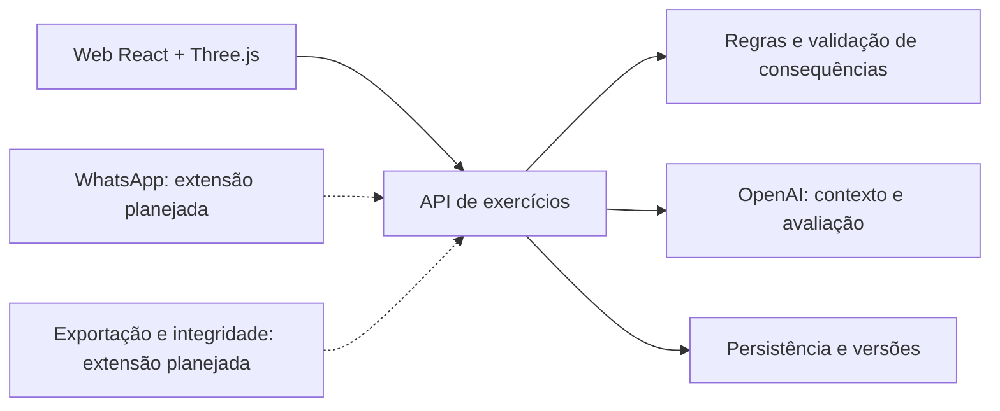

# Frontline — produto e experiência

Versão 1.0 · 23 de outubro de 2026

**Estado:** especificação de um protótipo em desenvolvimento. Funcionalidades descritas como planejadas não são alegações de funcionamento. As [idealizações visuais](../visuals/index.html) orientam o design; a versão executável precisa ser validada separadamente.

## 1. Proposta de valor

Frontline transforma situações difíceis de atendimento em exercícios narrativos: a pessoa conversa, toma decisões, observa consequências e experimenta outra resposta. A proposta combina preparação, prática, evidência e comparação em uma experiência curta.

O primeiro recorte é o atendimento de pós-venda no comércio eletrônico. Um ambiente 2.5D apresenta informações úteis à decisão; a conversa acontece por texto. O foco é praticar a aplicação de regras, a comunicação de limites e a negociação de um próximo passo viável.

## 2. Problema e evidências

**Hipótese central:** conhecer um procedimento não garante conseguir aplicá-lo numa conversa sob pressão, sobretudo quando o cliente precisa de algo que a operação não consegue prometer.

Há precedentes públicos de organizações investindo em prática contextual:

| Caso | Evidência publicada | Limite de interpretação |
|---|---|---|
| Bank of America, 2021 | Anúncio de treinamento virtual para conversas difíceis com clientes e orientação sobre lacunas | Relato da empresa; conforto autodeclarado não comprova competência nem efeito do Frontline |
| Walmart, 2018 | Expansão de treinamento imersivo para profissionais da linha de frente, incluindo atendimento e empatia | Programa amplo; não isola o efeito de conversas simuladas |
| Hilton e SweetRush | Caso de treinamento que combina situações de atendimento, narrativa, ramificações e feedback | Relato do fornecedor e precedente próximo; a combinação não é exclusiva do Frontline |

Esses casos sustentam a relevância do campo. Não demonstram prevalência do problema no Brasil, demanda pelo Frontline ou eficácia educacional do produto.

| Família de dificuldades | Situação concreta | Resposta proposta |
|---|---|---|
| Aplicar conhecimento sob pressão | Identificar a necessidade e responder sem garantir o impossível | Episódio com fatos, limites e consequências observáveis |
| Conseguir praticar com contexto | Exercícios distantes do cotidiano ou difíceis de preparar | Relato curto convertido em rascunho revisável, dentro de um domínio suportado |
| Transformar feedback em ação | Saber exatamente qual fala rever e por quê | Três critérios, citações da conversa e nova tentativa comparável |

As duas últimas famílias permanecem hipóteses de oportunidade a validar com usuários.

## 3. Personas e papéis

### Mariana Oliveira — participante

Persona fictícia de design, 23 anos, atendente iniciante em uma empresa de comércio eletrônico. Tem familiaridade com tecnologia e pouca experiência com clientes frustrados. Quer praticar respostas, consultar a regra adequada e compreender como melhorar uma conversa.

- **Objetivo:** conduzir um atendimento difícil com mais preparo e sem promessas inviáveis.
- **Dificuldade:** reagir à pressão enquanto precisa interpretar informações e limites operacionais.
- **Necessidade de produto:** preparação simples, exercício curto, feedback específico e repetição.
- **Ações principais:** escolher ou criar situação, revisar, consultar, responder, pausar, comparar e retomar.

### Roberto Almeida — personagem

Cliente fictício, 42 anos, cujo aparelho está em assistência. Ele viaja no dia seguinte e precisa manter contato com a família. Roberto é o único interlocutor da sessão; suas respostas devem respeitar os fatos e as regras do cenário.

Roberto não é uma segunda persona de usuário, nem uma pessoa real reproduzida pelo sistema.

### Liderança de atendimento — possível comprador

Uma supervisora pode futuramente preparar exercícios para a equipe. Essa possibilidade não inclui, nesta entrega, painel de RH, ranking individual, certificação ou acesso automático a conversas privadas.

## 4. Mercado e posicionamento

O segmento inicial compreende profissionais iniciantes de suporte, SAC, varejo e comércio eletrônico. O usuário é quem pratica; um comprador empresarial possível é a área de treinamento ou liderança de atendimento.

Não há dimensionamento quantitativo, preço testado ou demanda validada. Uma estimativa futura deve explicitar empresas alcançáveis, profissionais elegíveis, adoção e preço, com fontes ou resultados de teste para cada fator.

Alternativas incluem treinamento presencial, scripts, bases de conhecimento, cenários fixos e roleplay com IA. Yoodli já oferece roleplay textual com critérios e feedback. Hilton/SweetRush aproxima narrativa, simulação e avaliação. A oportunidade a investigar é reduzir o esforço do ciclo **contexto próprio → exercício coerente → consequência verificável → alternativa comparável**.

## 5. Jornada e funcionalidades

**Biblioteca → situação → revisão → ensaio → documentos e respostas → consequência → avaliação → nova tentativa → comparação e retomada.**

| Tela | Conteúdo e ação principal | Resultado esperado | Escopo |
|---|---|---|---|
| F01 Biblioteca | Episódios, tentativas, última atividade; criar ou continuar | Abrir a sessão correta sem criar uma tentativa por navegar | Núcleo |
| F02 Criar situação | Relato, objetivo e regras curtas | Produzir rascunho revisável sem perder o texto em caso de erro | Núcleo |
| F03 Revisar contexto | Fatos, lacunas, premissas, regras e três critérios | Confirmar uma versão do exercício; resolver contradições antes de iniciar | Núcleo |
| F04 Ensaio 2.5D | Cliente, conversa, documentos, contador e compromisso atual | Responder e observar consequências compatíveis com as regras | Núcleo |
| F05 Documento e pausa | Ordem de serviço, política, agenda e rascunho preservado | Consultar, pausar e retomar sem contar a mesma consulta duas vezes | Núcleo |
| F06 Avaliação | Final, três critérios, citações e oportunidade de melhoria | Entender a relação entre fala, regra e consequência | Núcleo |
| F07 Comparação | Duas tentativas, divergência e compromissos | Experimentar uma alternativa mantendo o percurso original | Núcleo |
| F08 Vincular WhatsApp | Estado desconectado, vínculo temporário e confirmação | Associar o canal à identidade correta | Expansão planejada |
| F09 Retomar pelo WhatsApp | Contexto recebido, último episódio e link | Continuar na mesma sessão; revogar o vínculo quando necessário | Expansão planejada |
| F10 Registro e exportação | Versões, conteúdo exportado e integridade | Gerar registro portátil e, opcionalmente, verificar a cópia | Expansão planejada |

Cada fluxo precisa de vazio, carregamento, erro e recuperação apropriados. Os dez visuais cobrem as vistas principais, não todas as combinações de estado.

### Histórias de uso e critérios

- Como participante, quero escolher um exercício pronto para começar sem configurar a plataforma.
- Quero descrever uma situação e revisar fatos antes que ela se torne um exercício.
- Quero saber quais informações são desconhecidas, sem vê-las transformadas em fatos pela narrativa.
- Quero consultar documentos sem perder a conversa ou o texto que estava escrevendo.
- Quero uma reação ligada ao que respondi e às condições do cenário.
- Quero pausar e recuperar o último estado confirmado.
- Quero reenviar uma ação que falhou sem duplicar a fala ou o efeito.
- Quero uma avaliação com exemplos literais e uma orientação concreta.
- Quero refazer o exercício e comparar versões equivalentes.
- Quero saber quando estou vendo uma simulação determinística ou uma resposta produzida pelo serviço de IA.
- Futuramente, quero trazer contexto pelo WhatsApp, controlar esse vínculo e exportar meu registro.

## 6. Episódio: A viagem de amanhã

A data ficcional do exercício é 23 de outubro de 2026. Roberto viaja em 24 de outubro às 18h e retorna no dia 27. A peça necessária ao reparo não tem prazo confirmado. Há um aparelho provisório disponível, sem cobrança, mediante documento de identificação e devolução em até sete dias, até 30 de outubro.

O cliente precisa confirmar as condições. O sistema não presume documento ou data de devolução para facilitar o desfecho. Nenhum empréstimo ou reserva real é executado.

| Desfecho | Condição |
|---|---|
| Alternativa viável combinada | Disponibilidade e condições verificadas; cliente aceita o provisório; reparo continua sem prazo |
| Próximo passo combinado | Atualização concreta acordada sem promessa indevida; a necessidade material pode continuar pendente |
| Promessa sem respaldo | Participante mantém garantia incompatível com os fatos do cenário |

Cancelamento ou incompletude são estados da sessão, não novos finais narrativos. Encaminhar honestamente uma demanda não significa fracasso automático.

O recorte demonstrativo tem um cliente, um ambiente, três decisões e até oito unidades visíveis: abertura, três falas da participante, duas respostas intermediárias, resposta final e devolutiva. A contagem é uma interpretação conservadora do limite do desafio.

**Critérios do exercício:** compreender a necessidade; comunicar com clareza e verdade; combinar uma solução viável. Cada um admite observado, parcialmente observado, não observado ou evidência insuficiente. Não há nota psicológica nem certificado de habilidade.

**Atributos narrativos:** preparo, ligado à consulta de dois documentos, e autonomia de negociação, ligada à consulta da política e confirmação de condições. Abrir um documento não comprova aprendizado; poder propor um acordo não significa que ele já foi aceito.

## 7. Adaptação, regras e dados

O desenho prevê que a IA organize contexto, represente o cliente e avalie a conversa. O servidor decide se uma consequência é permitida. O modelo não pode inventar estoque, prazo ou autorização para atender a uma promessa.

Na implementação inicial, a adaptação é limitada ao domínio de aparelho em assistência. Os controles executáveis são disponibilidade do provisório e prazo de empréstimo de um a sete dias. Texto livre de política não altera automaticamente regras operacionais; não há geração de qualquer profissão ou mundo 3D arbitrário.

| Entidade | Informação e restrição |
|---|---|
| ContextDraft | Texto original, rascunho e revisão; extração não equivale a confirmação |
| ScenarioVersion / RubricVersion | Fatos, regras, personagem e critérios congelados por tentativa |
| TrainingSession | Dono, posição, contagem, atributos e compromisso; revisão monotônica |
| Message / Decision | Fala literal, interpretação e consequência validada |
| Checkpoint | Estado que permite nova tentativa preservando o percurso anterior |
| Assessment / Citation | Critério, trecho e mensagem de origem; citação deve corresponder literalmente |
| CommandReceipt / DomainEvent | Identidade e sequência da ação; reenvio não duplica efeito |
| ChannelLink | Vínculo autorizado, expiração e revogação, quando implementado |
| ExportManifest | Versões e hashes; integridade distinta de verdade ou qualidade |

Estados previstos: rascunho editando/gerando/pronto/falhou; sessão ativa/pausada/avaliando/concluída/incompleta/cancelada; envio pendente/confirmado/falhou; vínculo pendente/conectado/vencido/revogado.

## 8. Arquitetura e integrações

| Componente | Versão inicial ou destino | Situação |
|---|---|---|
| Interface | React, Vite e Three.js | Código inicial; jornada e fidelidade visual em validação |
| API | Node.js, contratos HTTP e validação de regras | Protótipo local |
| Banco | SQLite nativo; PostgreSQL/Neon como alvo cloud | Local no código; migração planejada |
| OpenAI | Responses API com saídas estruturadas | Adaptador presente; teste completo do produto pendente |
| Vercel / Railway | Web e API, respectivamente | Destinos previstos; publicação deve ser verificada |
| Cloudinary | Recursos visuais autorizados | Opcional; catálogo local suficiente ao núcleo |
| WhatsApp | Entrada de contexto e retomada | Integração do produto planejada |
| Solana Devnet | Recibo opcional de integridade de exportação | Integração do produto planejada |
| E-mail | Link de revisão solicitado | Opcional, fora do núcleo |

Papéis de geração, interlocução e avaliação não exigem microserviços separados. Um backend com contratos claros conserva o mesmo estado entre interfaces; a ponte de mensagens pode ser um adaptador isolado.

### Continuidade pelo WhatsApp

A experiência planejada começa com usuário autenticado, código temporário de uso único e confirmação do vínculo na web. Depois, uma mensagem pode iniciar um rascunho ou retornar um link autorizado à sessão. O ambiente 2.5D permanece no navegador. Revogação bloqueia acessos futuros; mensagens repetidas não devem duplicar sessões.

A identidade de visitante da versão local não resolve sozinha autenticação entre dispositivos. A integração exige essa camada antes de ser anunciada como disponível.

### Exportação e integridade

Uma cópia pode conter transcrição, critérios, versões e resultado. Um recibo opcional em Solana Devnet permite verificar correspondência com o registro ancorado. Não são publicados nome, telefone ou transcrição na cadeia. A verificação não certifica habilidade, verdade do atendimento ou correção da avaliação; falha de ancoragem não deve impedir o treino.

## 9. Qualidade, privacidade e limites

O produto deve demonstrar duas trajetórias coerentes, limite de turnos, persistência, recuperação de erro e citações verificáveis. Cena e lista precisam fornecer as mesmas informações essenciais. Regras modificadas devem alterar possibilidades, não apenas texto.

O fluxo completo com modelo real, navegador, persistência e endereço final permanece sujeito a testes. Não se afirma melhoria de retenção ou desempenho profissional sem estudo apropriado. Use dados fictícios ou autorizados e evite informações pessoais de clientes reais.

## 10. Referências

- [Bank of America: anúncio de treinamento virtual, 2021](https://www.prnewswire.com/news-releases/bank-of-america-is-first-in-industry-to-launch-virtual-reality-training-program-in-nearly-4-300-financial-centers-301395210.html).
- [Walmart: treinamento com realidade virtual, 2018](https://corporate.walmart.com/news/2018/09/20/how-vr-is-transforming-the-way-we-train-associates).
- [SweetRush: caso Hilton, treinamento imersivo e IA](https://www.sweetrush.com/case-studies/generative-ai-immersive-training-sweetrush-and-hilton).
- [Yoodli: roleplays por chat](https://support.yoodli.ai/en/articles/15862405-create-chat-based-roleplays).
- [Guia do evento e critérios de avaliação](https://openaihackathon.com.br/).

Veja também o [guia de estilo](style-guide.md), a [galeria](../visuals/index.html) e o [roteiro de demonstração](demo.md).
